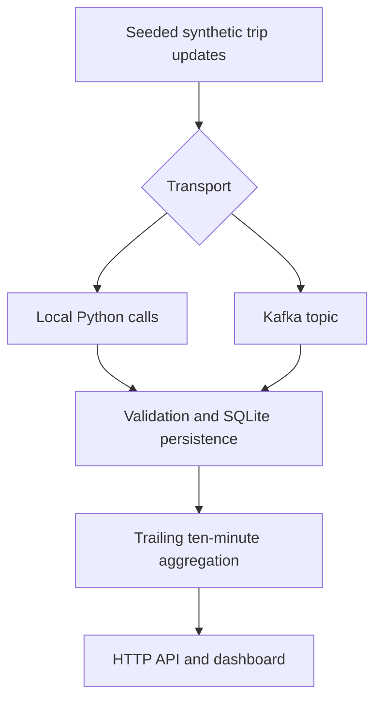

# Urban Transit Delay Intelligence Platform

A runnable local transit analytics demonstration: synthetic trip updates are
validated, stored with replay protection, aggregated into route delay metrics,
and displayed in a dashboard that polls the actual API output.

**Source: simulated transit data.** This project does not currently ingest a
verified live agency feed or predict delays. The working reference path uses
Python and SQLite. An optional Kafka Compose path is included; the earlier
Spark/Delta, HBase, Airflow and dbt designs remain experimental.

## Run locally (Python 3.10+, no third-party packages)

From the repository root:

```bash
python -m transit.app local
```

Open **http://127.0.0.1:8000**. The producer emits 60 synthetic trip updates every
five seconds. The RED route deliberately has half its trips delayed; BLUE and
GREEN stay below the rule threshold. The dashboard displays database-derived
metrics, not browser-generated values. It shows disconnected and stale states.

```bash
python -m unittest discover -s tests -v
```

Options: `--port 8001`, `--interval 10`, `--db data/example.db`. Stop with Ctrl+C.
The default database is `data/transit.db` relative to the working directory.
Restarting preserves history; exact event replays do not create additional rows.
Use a different `--db` path for a fresh demonstration.

## Data flow



The default path runs simulator, persistence and HTTP server in one process.
The Kafka path runs a producer and consumer separately, using the same event
contract and aggregation code.

## Optional Kafka + Docker Compose

Requires Docker with the Compose plugin:

```bash
docker compose up --build -d
docker compose ps
docker compose logs --tail=100 dashboard simulator
```

Open http://127.0.0.1:8000. Kafka must become healthy and the topic initializer
must finish before the consumer and simulator start. `/health` becomes ready
only after fresh data arrives and the consumer thread is alive.

```bash
curl --fail http://127.0.0.1:8000/health
curl --fail http://127.0.0.1:8000/api/routes
docker compose down
```

Named volumes preserve both Kafka logs and the SQLite database. Do not reset
one while keeping the other's consumer offsets unless you explicitly arrange
a replay. `docker compose down --volumes` resets **both** and deletes demo data.
The broker is internal to the Compose network; the dashboard binds to localhost.
This is a single-node development setup, without TLS, authentication or HA.

The broker configuration follows the [official Apache Kafka Docker guidance](https://kafka.apache.org/39/getting-started/docker/).
Docker was unavailable in the local authoring environment. The Kafka Compose
build/startup and consumed-event smoke check subsequently **passed in GitHub
Actions** on 2026-10-28. See [VALIDATION.md](VALIDATION.md) for the linked run and
verification boundary.

## Metric contract and reliability

- Input: agency, route ID, trip ID, service date, timezone-aware timestamp,
  and a nonempty list of stop updates with numeric arrival delays.
- Delays must be finite and between -120 and 7,200 seconds; missing fields,
  malformed dates and timestamps more than 60 seconds in the future are rejected.
- Content hashes prevent exact replays. Rejected payload hashes and reasons are
  recorded separately; rejection counts are unique rejected payloads.
- One trip means one `(agency, route, trip_id, service_date)` in the trailing
  ten-minute wall-clock window. Repeated updates and multiple stops do not
  increase the trip denominator. The maximum arrival delay in that window is used.
- A trip is delayed at **180 seconds or more**. A route is flagged at **35% or
  more delayed trips**. This is a configurable-in-code demonstration rule, not
  evidence of causal delay propagation or an ML forecast.
- Out-of-order events inside the window are included. Older events remain in
  history but leave the active read model. No event in 60 seconds means stale.
- The Kafka consumer commits offsets only after a durable write or quarantine.
  Delivery is at least once; hashes handle exact replays. This is not a claim of
  transactional exactly-once processing across Kafka and SQLite.
- No retention policy is implemented. SQLite query cost and disk use grow with
  history; this is a bounded portfolio demonstration, not a scale benchmark.

## Repository map

| Path | Status |
|---|---|
| `transit/` | Runnable simulator, validator, storage, consumer and HTTP server |
| `dashboard/index.html` | Connected UI; no generated browser metrics |
| `tests/test_pipeline.py` | Replay, window, grain, threshold, rejection and HTTP tests |
| `compose.yaml`, `Dockerfile` | Optional Kafka deployment; requires runtime verification |
| `spark/delay_detection.py` | Experimental original Spark/Delta/HBase design |
| `airflow/dags/transit_dags.py` | Experimental DAGs; referenced training/profile jobs are absent |
| `dbt/models/transit_models.sql` | Design sketch containing multiple models; not a dbt project |
| `kafka/gtfs_producer.py` | Earlier GTFS producer prototype; feed URLs/auth are unverified |

The experimental files are preserved for future work and are **not invoked** by
the supported commands above. HBase integration, Spark aggregation correctness,
separate dbt models and source definitions, trained ML artifacts, and verified
agency-feed adapters still need implementation/integration work. Do not use the
old prototype quick-start commands or claim those layers were validated.

## Portfolio wording

“Built and locally tested a simulated transit-event pipeline with replay-safe
persistence, ten-minute route delay aggregation, rejected-record tracking and
an API-backed dashboard; added an optional Kafka Compose deployment.”

No production latency, throughput, forecast accuracy or business-impact figure
is claimed. Local tests do not prove that the Kafka/Spark cloud stack is deployed.
